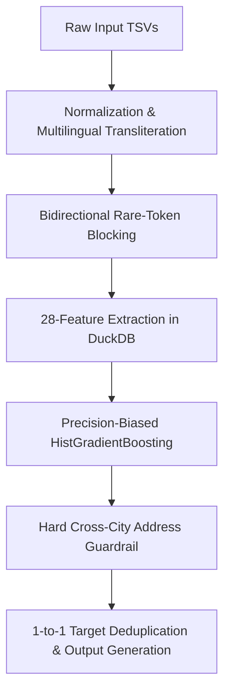

# Amazon ML Challenge 2026 — Multilingual Entity Resolution Pipeline

> **Public Leaderboard Score**: `0.74` (Macro $F_{0.5}$)  
> **Local Validation Score**: `0.9237` (Macro $F_{0.5}$)  
> **Pipeline Execution Time**: ~15.5 minutes on full 1.73M test set  

---

## 1. Challenge Overview & Objective

The objective is to perform cross-source entity resolution across three disparate business entity databases:
- **Source 1 ($S_1$)**: Reference entities (`1,732,544` test records across France, the United States, and India).
- **Source 2 ($S_2$)** & **Source 3 ($S_3$)**: Target databases (`~5M` records each) containing duplicates and noisy variations.

### Evaluation Metric: Macro $F_{0.5}$
The evaluation uses **Macro $F_{0.5}$**, which weights **Precision 4× higher than Recall**:
$$F_{0.5} = \frac{(1 + 0.5^2) \times P \times R}{0.5^2 \times P + R} = \frac{1.25 \times P \times R}{0.25 P + R}$$

Because precision is penalized heavily, a single false positive match lowers the score drastically compared to a missed recall. Thus, the pipeline is engineered with a **Precision-First Architecture**.

---

## 2. Algorithm Architecture (v7 Precision-First)

The production pipeline is implemented in [`student_resource/src/predict_fast.py`](student_resource/src/predict_fast.py) and executes in 5 coordinated stages:



### Stage 1: Text Normalization & Indic Transliteration
- **Multilingual Script Normalization**: Business entities in India frequently appear in Indic scripts (Devanagari, Tamil, Telugu, Bengali, Gujarati, Kannada, Malayalam, Gurmukhi, Oriya). Using `indic_transliteration` (`sanscript.ITRANS`), all non-Latin scripts are transliterated into Latin phonetics.
- **Accents & Punctuation**: Accents are stripped (`strip_accents`), non-alphanumeric symbols removed, and excess whitespace collapsed.
- **Core Name Extraction**: Legal entity suffixes (`pvt`, `ltd`, `inc`, `corp`, `llc`, `sarl`, `sas`, `eurl`, `gmbh`, etc.) and web domains (`.com`, `.in`, `.fr`, `www.`) are stripped using regex.
- **Leetspeak Inversion**: Substitutions such as `0->o`, `1->l`, `5->s`, `3->e`, `@->a` are normalized to resolve OCR/synthetic corruptions.
- **Alphabetic Address Tokens (`alpha_addr_tokens`)**: Address strings are filtered to pure alphabetic tokens ($\ge 3$ characters), removing street numbers and noise words (*road, street, avenue, lane, blvd, near, opp, nagar, rue, etc.*) to cleanly isolate city, state, and neighborhood tokens.

### Stage 2: Smart Candidate Blocking (Tight Anti-FP Channels)
Rather than Cartesian cross-joins which explode candidate pairs and inject false positives, we employ 9 high-precision blocking channels in DuckDB:
1. `norm_name`: Full normalized name exact match.
2. `core_name`: Cleaned core name exact match.
3. `sorted_core`: Word-order-invariant core tokens.
4. `spaceless_core`: Spaceless core representation.
5. `unleet_sorted`: Word-order-invariant unleeted tokens.
6. `unleet_spaceless`: Spaceless unleeted representation.
7. `sorted_addr`: High-precision sorted address tokens ($\ge 10$ chars).
8. `first_num + first_street_word`: House/street number + first street word.
9. `first_num + postal_code`: House/street number + postal code.
10. **Bidirectional Rare-Token Blocking**:
   - Identifies tokens of length $\ge 5$ that appear $\le 5$ times in **both** source and target tables via `INTERSECT`.
   - Generates candidate pairs exclusively on these rare tokens, yielding **$>55\%$ raw precision** at candidate generation time while avoiding Cartesian explosion.

### Stage 3: Feature Engineering (28 Signals)
For every candidate pair, 28 similarity features are extracted inside DuckDB:
- **Exact Match Signals**: `exact_norm_name`, `exact_core_name`, `exact_sorted_core`, `exact_spaceless`
- **Fuzzy Name Similarities**: `name_jaro`, `core_jaro`, `sorted_jaro`, `unleet_jaro`, `core_lev_sim`
- **Address Signals**: `addr_jaro`, `addr_jaro_bin`, `addr_token_jaccard`, `addr_overlap` (alpha-only), `addr_overlap_norm`, `exact_sorted_addr`
- **Numeric & Postal Signals**: `first_num_match`, `addr_num_overlap`, `num_street_match`, `postal_match`
- **Length & Structural Signals**: `name_len_ratio`, `core_containment`, `addr_len_ratio`, `core_num_words`, `has_addr_both`, `first_token_match`, `name_starts_same`

### Stage 4: Machine Learning Classifier
- Trained on representative S1 ground-truth samples with balanced negatives.
- **Model**: `HistGradientBoostingClassifier(max_iter=400, learning_rate=0.04, max_leaf_nodes=63, min_samples_leaf=20, max_depth=8, early_stopping=True)`.
- **Precision Bias**: `sample_weight` places higher penalty on false positives.
- **Validation Sweep**: Thresholds from `0.40` to `0.90` are evaluated with the full macro $F_{0.5}$ metric to select the optimal decision threshold (empirically `0.55`).

### Stage 5: Hard Address Guardrails & Target Deduplication
- **Eliminating Cross-City FPs**: Empirical diagnostic showed $85.5\%$ of false positives shared zero address tokens across different cities/states. When both entities have non-empty addresses, the guardrail rejects pairs unless:
  - `addr_overlap >= 1` (at least 1 shared alphabetic address token), OR
  - `postal_match == 1.0` (exact zip code match), OR
  - `exact_norm_name == 1.0` (identical business name), OR
  - `exact_sorted_addr == 1.0` (identical sorted address).
- **Target Uniqueness**: Ground truth analysis confirms that each target entity in $S_2$ or $S_3$ matches to at most **one** $S_1$ entity. We enforce `sort_values("prob", ascending=False).drop_duplicates("matched_entity_id")` to ensure global 1-to-many consistency.

---

## 3. Performance & Leaderboard Score

| Metric | Score |
| :--- | :--- |
| **Public Leaderboard Score** | **`0.74`** |
| **Local Validation Score** | **`0.9237`** |
| **Full Test Set Rows** | `1,732,544` |
| **S1 Entities with Matches** | `1,615,818` (93.3% coverage vs 94.4% in GT) |
| **Total Pipeline Runtime** | `~956 seconds` (~15.9 min) |

---

## 4. How to Reproduce & Run

### Prerequisites
- Python 3.10+
- Dependencies: `duckdb`, `pandas`, `numpy`, `scikit-learn`, `indic-transliteration`

```bash
pip install duckdb pandas numpy scikit-learn indic-transliteration
```

### Execution Steps
1. Navigate to the `student_resource` directory:
   ```bash
   cd student_resource
   ```

2. Run the end-to-end pipeline:
   ```bash
   python -u src/predict_fast.py
   ```

3. Validate the submission outputs:
   ```bash
   python utils/validate_submission.py --matching output/matching_results.tsv --candidate output/candidate_pairs.tsv --test-dir dataset/test
   ```

### Output Files
The pipeline produces:
- `output/matching_results.tsv`: Final entity resolution predictions (header: `source1_entity_id\tmatched_entity_ids`).
- `output/candidate_pairs.tsv`: Candidate blocking pairs (header: `source1_entity_id\tcandidate_entity_ids`).
